# Drill Down

개념을 **트리로 쪼개 적고**, 그 트리를 그대로 **플래시카드·빈칸·백지 퀴즈로 외우는** 학습 웹앱.

보통의 플래시카드는 "단어 → 뜻"이 일대일이다. Drill Down 은 개념 하나가 여러 하위 개념으로 뻗는 트리를 만들고, 위에서 아래로 전체 구조를 먼저 떠올린 뒤 세부를 채우는 방식으로 외우게 한다. 상위 개념만 보이다가 누르면 하위가 차례로 열리는 방식이 이름의 유래다.

- 로그인 없이 바로 쓴다. 데이터는 브라우저(IndexedDB)에 먼저 저장되고, 로그인하면 서버와 동기화돼 다른 기기에서도 이어진다.
- 푼 결과는 간격 반복 알고리즘(FSRS-7)이 다음 복습 시점을 정하고, 카드 색으로 숙련도가 보인다.
- PWA. 설치할 수 있고 두 번째 방문부터는 오프라인에서도 편집·학습이 된다.
- PC 와 모바일(터치·소프트 키보드) 양쪽에 맞춘 화면.

## 화면

### 내 트리

트리 목록. 제목을 적고 Enter 면 트리가 생긴다. 카드마다 세 학습 모드로 바로 들어가는 버튼이 있고, 더 보기(…)에서 이름 변경·공유·삭제를 한다. 삭제는 확인 창 없이 휴지통으로 가고 토스트에서 되돌린다.

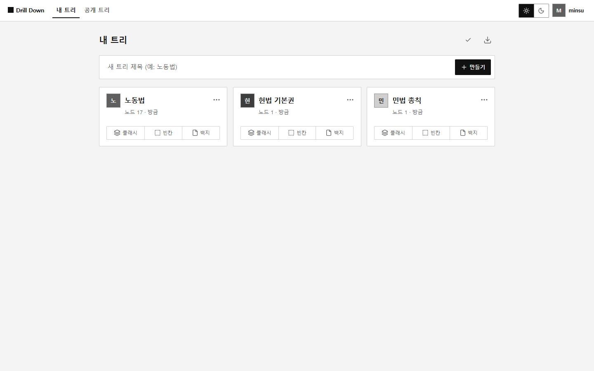

### 편집기

카드 그래프 하나로 트리를 편집한다. 개요(들여쓰기한 텍스트)를 붙여넣어 한 번에 수십 개 노드를 만들 수 있고, 키보드만으로 추가·이동·들여쓰기·잘라내기가 된다. 오른쪽 패널에서 제목·별칭(동의어, 채점 때 정답으로 인정)·내용을 고친다. 상단의 `1 2 3 ∞` 는 보이는 깊이, 그 옆은 배율·검색·단축키 안내다.

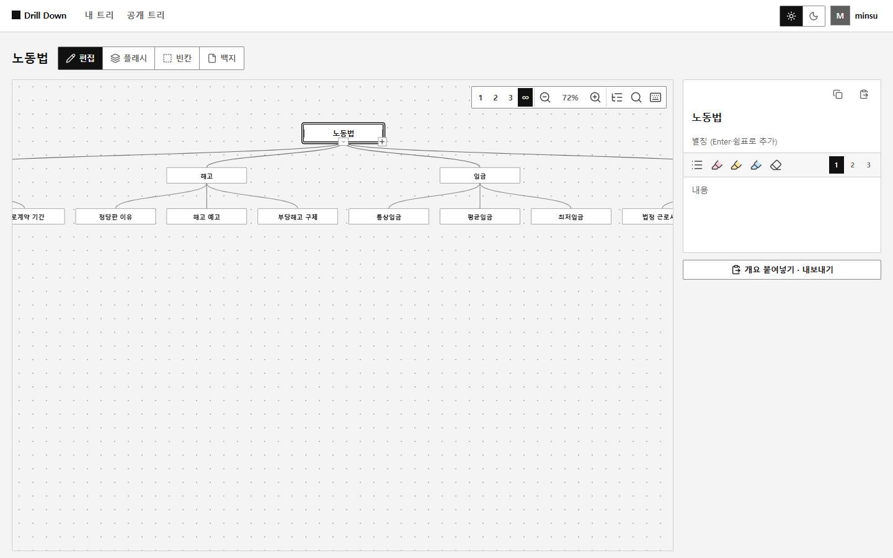

노드를 고르면 경로와 "이 가지만 보기"가 뜨고, 다크 테마는 상단 바에서 바꾼다.

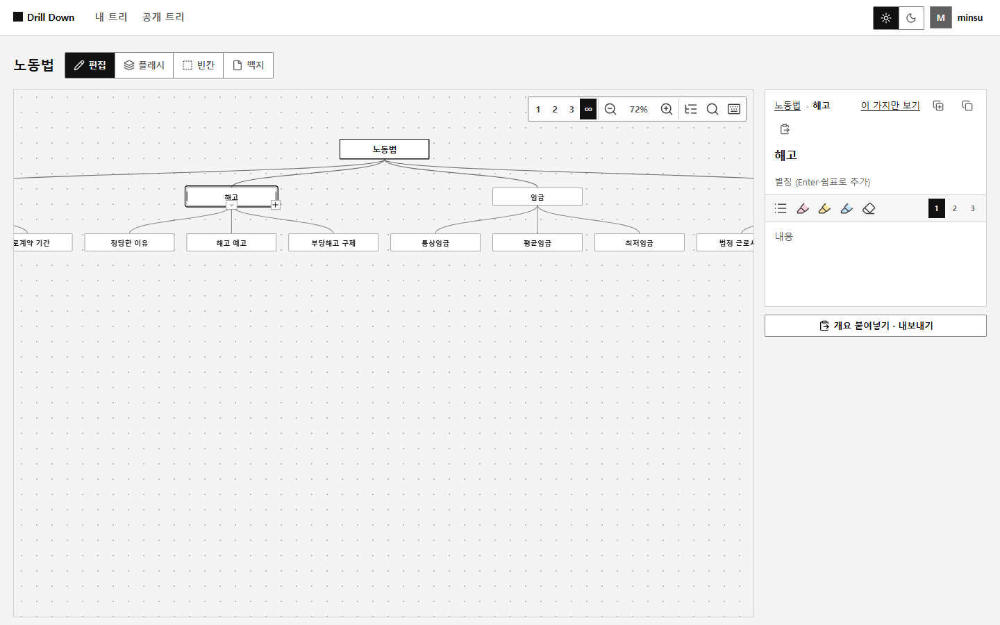
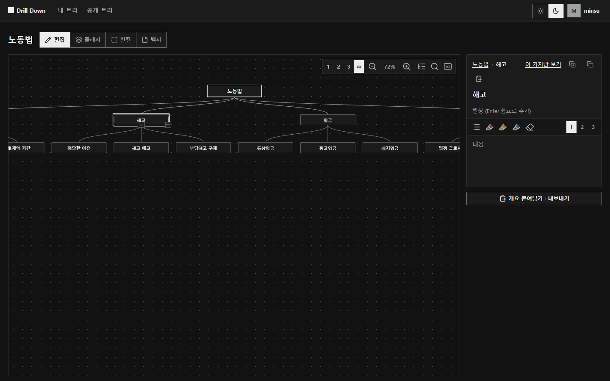

### 플래시카드

자식이 있는 노드가 문제다. 상위 개념을 보고 하위 개념을 떠올린 뒤 카드를 열어 자식마다 [알음]/[모름]을 누른다. 기록은 자식 노드에 남는다. 오른쪽 미니맵이 트리 전체의 숙련도를 색으로 보여 주고, "약점만"으로 틀린 것만 다시 돈다. 범위를 가지 하나로 좁힐 수도 있다.

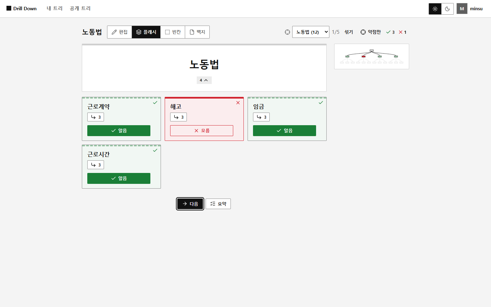

### 빈칸 퀴즈

리프 자리가 빈칸인 뼈대 트리와, 뽑아낸 카드가 섞인 보관함이 보인다. 카드를 끌어다 놓거나 누른 뒤 빈칸을 누른다. 채점은 "같은 부모 아래인가"만 본다. 형제 순서는 따지지 않는다.

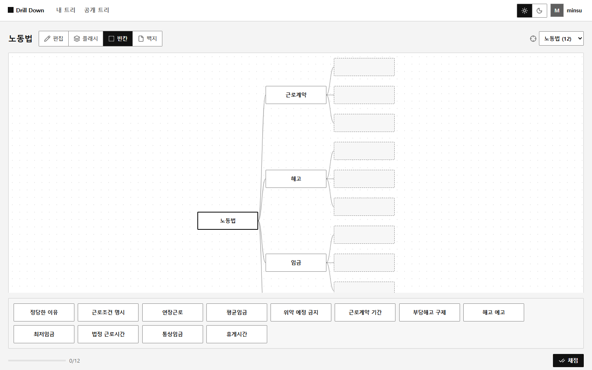

### 백지 퀴즈

루트만 남은 화면에서 트리 전체를 다시 조립한다. 루트부터 그 노드까지의 경로가 원본과 같아야 정답이다. 노드가 많으면 가지를 먼저 고르게 한다.

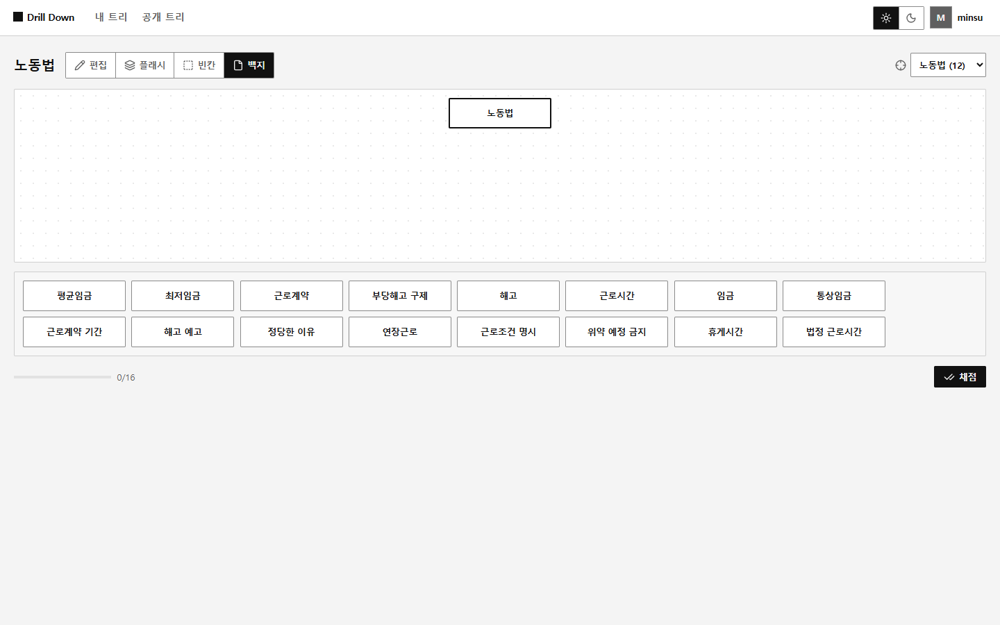

### 공유와 공개 트리

로그인하면 트리를 비공개 / 링크 / 공개로 바꿀 수 있다. 공유 링크(`/t/<slug>`)는 누구나 읽고, 플래시·빈칸·백지로 체험하고(기록은 남지 않음), 내 트리로 복제할 수 있다. 공개 트리는 목록에 올라가 별점·복제 수·제목 검색으로 찾는다.

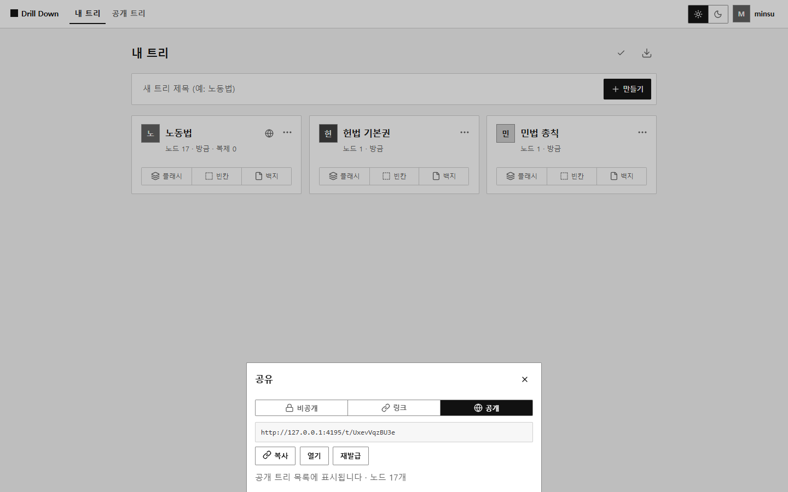
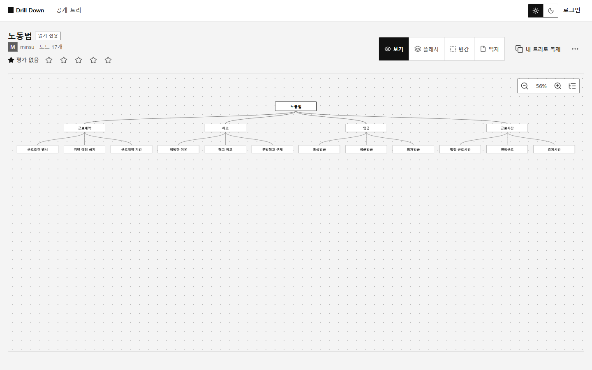
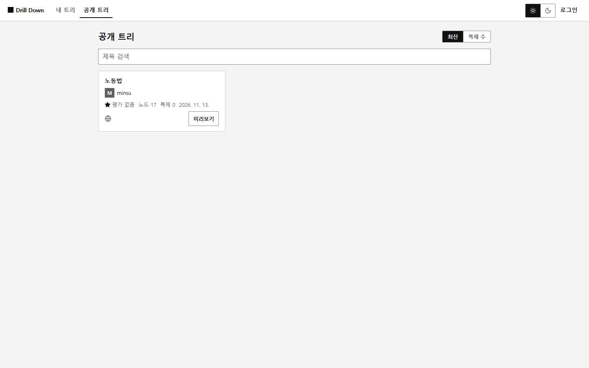

### 모바일

<p>
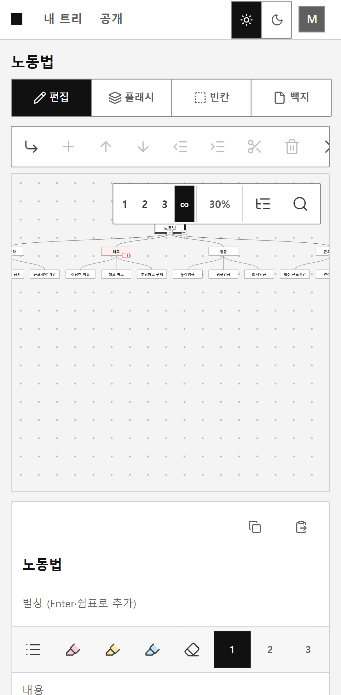
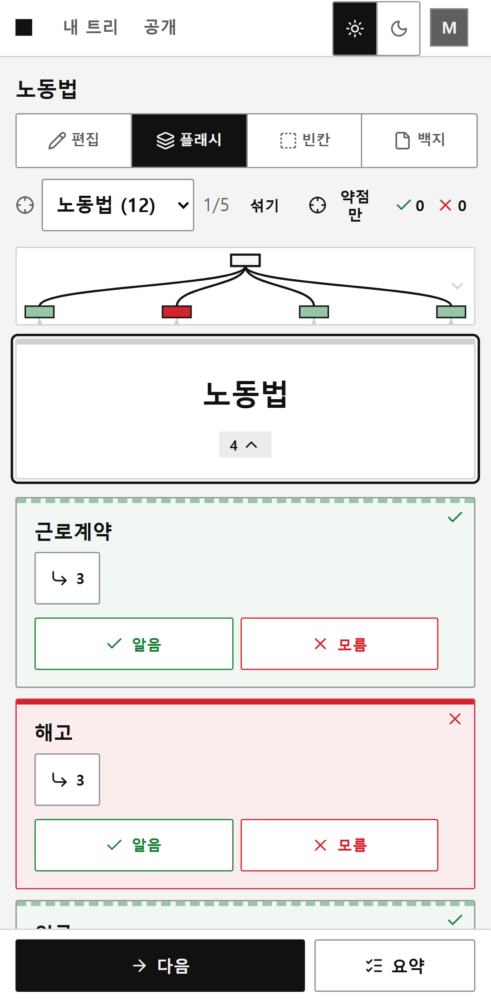
</p>

편집기는 터치용 도구 막대와 핀치 줌, 소프트 키보드 높이에 맞춘 레이아웃을 쓴다. 학습 모드는 한 손으로 넘기게 돼 있다.

## 색이 뜻하는 것

| 상태 | 색 |
|---|---|
| 마지막에 틀렸다 | 빨강 |
| 맞혔고 기억 확률 90% 이상 | 초록 |
| 기억 확률 80% 이상 | 연두 |
| 오래됐거나 아직 안 풀었다 | 없음 |

편집기 카드는 오답 횟수만큼 붉어진다. 자식 중 초록이 아닌 것이 있으면 부모는 연두로 낮춰 보인다.

## 기술

| | |
|---|---|
| 클라이언트 | React 19, Vite 8, Dexie(IndexedDB), ts-fsrs 6, vite-plugin-pwa |
| 서버 | Node 24, Hono, SQLite(node:sqlite). 프로세스 하나가 API·공유 HTML·정적 파일을 모두 낸다 |
| 로그인 | Google · 카카오 OAuth. 비밀번호 없음 |
| 동기화 | 브라우저가 "무엇이 바뀌었는지"만 outbox 에 적고 2초 뒤 push, 다른 기기는 번호 기준으로 pull |
| 배포 | Raspberry Pi + Cloudflare Tunnel (`deploy/`, `docs/ops/runbook.md`) |
| 테스트 | 자가 점검 스크립트(`npm run check`) + Playwright E2E 22개(Edge) |

첫 화면 전송량은 gzip 기준 약 86 KB(폰트 제외). 이후 화면 청크는 첫 화면이 뜬 뒤 유휴 시간에 받는다.

## 실행

```sh
npm ci
npm run dev          # 화면만: http://localhost:5173 (로그인 없이 편집·학습 가능)
npm run dev:server   # 로그인·동기화·공유까지: .env.example → .env 복사 후, 다른 터미널에서
npm run build && npm run server   # 운영과 같은 모양: http://localhost:3000
```

검사: `npm run typecheck` · `npm run lint` · `npm run check`(자가 점검) · `npm run e2e`(Edge 필요).

스크린샷 다시 찍기(위 이미지들을 `docs/screenshots/` 에 생성): `npx playwright test -c e2e-shots/pw.config.ts`

## 더 읽기

- `docs/CODEBASE.md` — 코드베이스 안내서(구조·원리·화면별 동작·동기화·서버·함정). 처음이면 여기부터.
- `docs/specs/` — 설계 문서, `docs/plans/` — 작업 기록.
